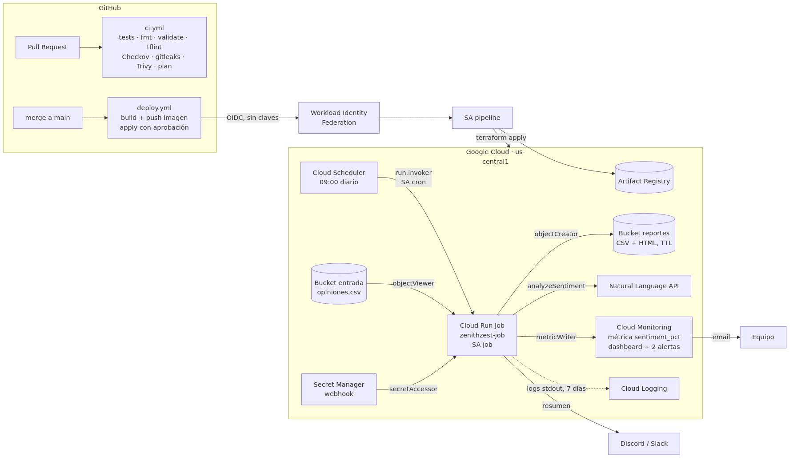

# ZenithZest — análisis de sentimiento de opiniones de clientes

Proyecto integrador 7 de Cloud Computing (UCU, 2026). Equipo: Avril Viega y Sebastián Cúneo.

Una empresa de jugos energéticos quiere saber si las opiniones sobre su marca son positivas o negativas.
Un **job de contenedor** corre **una vez por día** (y a mano cuando se quiera): lee `opiniones.csv` del bucket
de entrada, pide el sentimiento de cada línea a la **API de lenguaje**, escribe un **reporte CSV + HTML** en el
bucket de reportes, publica el **% positivo / negativo / neutro** como **métrica personalizada** y avisa el
resumen a un **webhook** cuya URL vive en **Secret Manager**.

Proveedor: **Google Cloud** (justificación en [docs/proveedor.md](docs/proveedor.md)).

```text
Cloud Scheduler (09:00 diario) ──▶ Cloud Run Job "zenithzest-job" (Python, imagen en Artifact Registry)
                                     ├─ lee gs://<proyecto>-zz-dev-entrada/opiniones.csv
                                     ├─ Natural Language API: sentimiento por línea
                                     ├─ escribe gs://<proyecto>-zz-dev-reportes/AAAA-MM-DD/reporte-*.csv|html
                                     ├─ métrica custom.googleapis.com/zenithzest/sentiment_pct{sentiment}
                                     └─ Secret Manager (webhook) ──▶ aviso a Discord/Slack
Cloud Monitoring: dashboard + alerta "% negativo > 40" + alerta "job fallido" ──▶ email al equipo
```

## Estructura

```text
app/                   job en Python (<150 líneas), Dockerfile multi-stage, tests
data/                  opiniones.csv (200) y opiniones_crisis.csv (40, para disparar la alerta)
scripts/               generador de los CSV de prueba
infra/bootstrap/       una sola vez, a mano: APIs, bucket del state, Artifact Registry, OIDC, presupuesto
infra/modules/         storage, job, scheduler, secret, monitoring
infra/envs/dev/        root module del entorno (main, iam, variables, outputs, providers, backend, dev.tfvars)
.github/workflows/     ci.yml (PR), deploy.yml (main), destroy.yml (manual), run-job.yml (manual)
docs/                  proveedor, arquitectura, diagramas UML (docs/uml), IAM, FinOps, seguridad, bitácora, presentación
```



Diagramas UML de despliegue, componentes, secuencia, actividad y casos de uso: [docs/diagramas-uml.md](docs/diagramas-uml.md).

## Desplegar

Requisitos: cuenta de Google Cloud con facturación (créditos) y este repo en GitHub. Los pasos manuales se hacen en
**Cloud Shell** (la terminal del navegador de la consola de Google Cloud, botón `>_`), que ya trae `gcloud` y git.
El resto lo corre GitHub Actions.

1. **Proyecto** (en Cloud Shell, ya autenticado)
   ```bash
   git clone https://github.com/aaavril/ZenithZest-Cloud.git && cd ZenithZest-Cloud
   gcloud projects create zenithzest-ucu-XXXX
   gcloud billing projects link zenithzest-ucu-XXXX --billing-account=XXXXXX-XXXXXX-XXXXXX
   gcloud config set project zenithzest-ucu-XXXX
   gcloud services enable cloudresourcemanager.googleapis.com serviceusage.googleapis.com iam.googleapis.com storage.googleapis.com billingbudgets.googleapis.com
   ```
   Cloud Shell **no trae Terraform**: se instala la misma versión que usa el pipeline, verificando el archivo:
   ```bash
   mkdir -p ~/.local/bin && cd /tmp && V=1.9.8      && curl -sSLO https://releases.hashicorp.com/terraform/${V}/terraform_${V}_linux_amd64.zip      && curl -sSLO https://releases.hashicorp.com/terraform/${V}/terraform_${V}_SHA256SUMS      && grep linux_amd64 terraform_${V}_SHA256SUMS | sha256sum -c -      && unzip -o -q terraform_${V}_linux_amd64.zip -d ~/.local/bin && export PATH="$HOME/.local/bin:$PATH" && cd -
   ```
   (Desde la compu, en cambio: instalar `gcloud` y Terraform y correr `gcloud auth application-default login`.)
2. **Bootstrap (una vez)**: copiar `infra/bootstrap/bootstrap.tfvars.example` a `bootstrap.tfvars`, completarlo y
   ```bash
   cd infra/bootstrap
   terraform init
   terraform apply -var-file=bootstrap.tfvars
   terraform output
   gcloud storage cp terraform.tfstate gs://zenithzest-ucu-XXXX-tfstate/bootstrap/terraform.tfstate  # respaldo del state del bootstrap
   ```
3. **Variables del repositorio** (GitHub → Settings → Secrets and variables → Actions → *Variables*, no secrets):
   `GCP_PROJECT_ID`, `GCP_REGION` (`us-central1`), `GCP_WIF_PROVIDER`, `GCP_SERVICE_ACCOUNT`, `TF_STATE_BUCKET`,
   `IMAGE_REPO` (salen del `terraform output` del bootstrap) y `ALERT_EMAILS` (`["correo1","correo2"]`).
4. **Environment `dev`** (Settings → Environments): agregar a ambos integrantes como *Required reviewers*.
5. **Push a `main`** → `deploy.yml` construye la imagen y, tras la aprobación, hace `terraform apply`.
6. **Cargar el secreto** (el valor nunca pasa por Terraform ni Git):
   ```bash
   printf '%s' "https://discord.com/api/webhooks/..." | gcloud secrets versions add zenithzest-webhook --data-file=-
   ```
7. **Probar**: Actions → `run-job` → `opiniones.csv`. Ver el reporte en el bucket de reportes y el dashboard
   (`terraform output dashboard_url`).

## Destruir

Actions → `destroy` → escribir `destruir`. El último paso muestra que el state quedó vacío (evidencia para el informe).
El bootstrap (bucket del state, registro, OIDC, presupuesto) se borra al final del curso con
`terraform destroy -var-file=bootstrap.tfvars` en `infra/bootstrap` (vaciar antes el bucket del state).

## Resultados (17/11/2026)

- **Primera corrida real:** 200 opiniones → 69 % positivas, 20 % negativas, 11 % neutras; reporte en el bucket y
  resumen recibido en Discord.
- **Crisis simulada** (`opiniones_crisis.csv`): 90 % negativas → la alerta "> 40 %" se disparó y llegó el mail.
- **Destroy:** todo el entorno borrado y el state verificado vacío.
- Problemas, causas y aprendizajes del proceso: [docs/bitacora.md](docs/bitacora.md).

**Presentación de la defensa:** [docs/presentacion/](docs/presentacion/README.md) (18 slides con notas del orador).

## Extras

- **Comparación con un modelo local:** `scripts/comparar_modelos.py` compara un reporte del job (API) con VADER
  adaptado al español: **91 % de coincidencia** sobre la corrida real
  ([docs/comparacion-modelos.md](docs/comparacion-modelos.md)). Para correrlo:
  ```bash
  pip install vaderSentiment==3.3.2
  python scripts/comparar_modelos.py reporte.csv --md docs/comparacion-modelos.md
  ```
- **Tendencia diaria del sentimiento:** gráfico de línea en el dashboard de Cloud Monitoring.

## Calidad y seguridad

- PR: tests de la app, `terraform fmt`/`validate`, `tflint`, Checkov (bloqueante), gitleaks, Trivy sobre la imagen,
  `terraform plan` publicado como comentario e Infracost (costo estimado del PR, si está el secreto `INFRACOST_API_KEY`).
- Sin claves de larga duración: GitHub Actions entra a Google Cloud por OIDC (Workload Identity Federation) y solo
  desde este repositorio.
- Detalle en [docs/seguridad.md](docs/seguridad.md) e [docs/iam.md](docs/iam.md).
