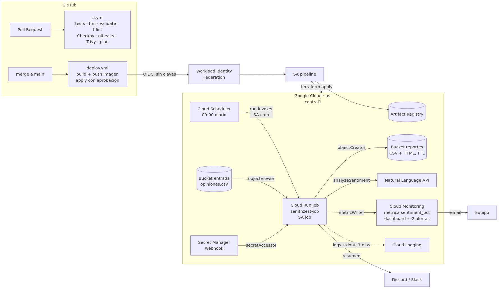

# Arquitectura

Diagramas UML (despliegue, componentes, secuencia, actividad y casos de uso) en [diagramas-uml.md](diagramas-uml.md).

Imagen generada desde `arquitectura.mmd` (diagrams-as-code, Mermaid). Para
regenerarla: `docker run --rm -u root -v "$PWD/docs:/data" minlag/mermaid-cli:11.4.2 -i /data/arquitectura.mmd -o /data/arquitectura.png -b white -w 1800`.

## Flujo de datos

1. Cloud Scheduler (cron `0 9 * * *`, zona `America/Montevideo`) hace `POST .../jobs/zenithzest-job:run`
   con un token OAuth de su propia cuenta de servicio.
2. El job lee `opiniones.csv` (hasta `MAX_OPINIONS` líneas) del bucket de entrada.
3. Por cada opinión llama a `analyzeSentiment` (idioma `es`): `score` de −1 a 1. Clasificación:
   `score ≥ 0,25` positivo · `score ≤ −0,25` negativo · resto neutro.
4. Escribe `AAAA-MM-DD/reporte-HHMMSS.csv` y `.html` en el bucket de reportes.
5. Publica tres puntos de `custom.googleapis.com/zenithzest/sentiment_pct` (label `sentiment`).
6. Lee la URL del webhook de Secret Manager y envía el resumen. Si el secreto no tiene valor, lo registra como
   WARNING y sigue (el job no falla por eso).
7. Logs estructurados en JSON por stdout → Cloud Logging (retención 7 días).

## Límites de seguridad

- Buckets privados: `public_access_prevention = enforced` y acceso uniforme (sin ACL por objeto).
- Ningún recurso tiene endpoint público: el job no es un servicio HTTP; solo se ejecuta por la API con IAM.
- Tres identidades separadas (pipeline, job, scheduler), cada una con lo mínimo (ver [iam.md](iam.md)).
- El único dato sensible (URL del webhook) vive en Secret Manager y se carga por CLI.

## Decisiones

| Decisión | Alternativa descartada | Motivo |
|---|---|---|
| Cloud Run **Jobs** | Cloud Run Service / Cloud Functions | Es un proceso batch que termina; no necesita endpoint HTTP público |
| Bootstrap separado del entorno | Todo en un root module | El bucket del state, el registro y el OIDC tienen que existir antes del primer pipeline |
| Imagen por SHA del commit | `latest` | Trazabilidad y rollback; validación en la variable `image` |
| Secreto vacío en Terraform | `google_secret_manager_secret_version` con el valor | El valor quedaría en el state |
| Alerta sobre la métrica de negocio y sobre fallos del job | Solo una | Una muestra el valor del negocio, la otra la salud técnica |
| Directorio por entorno (`envs/dev`) | Workspaces | Aislamiento fuerte; recomendado en clase |
