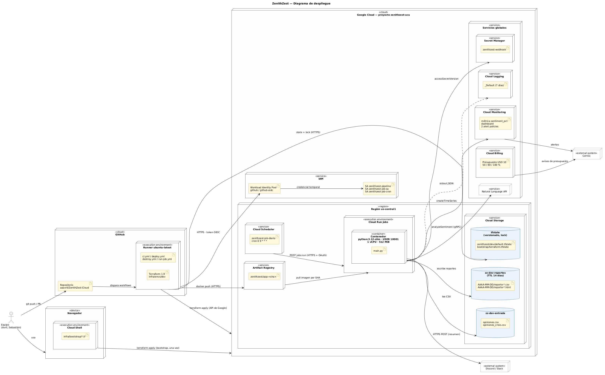
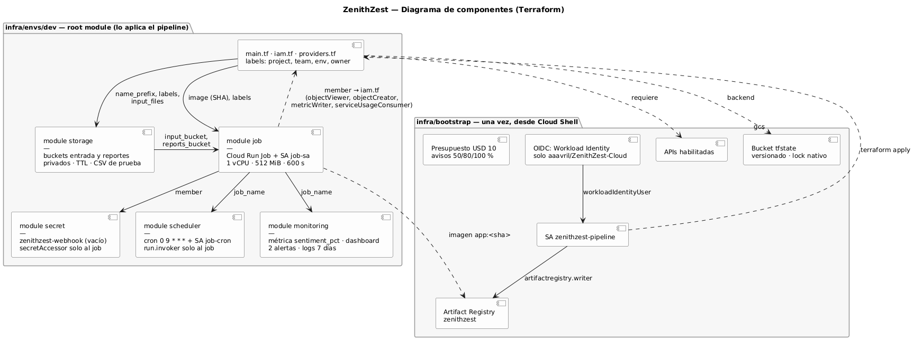
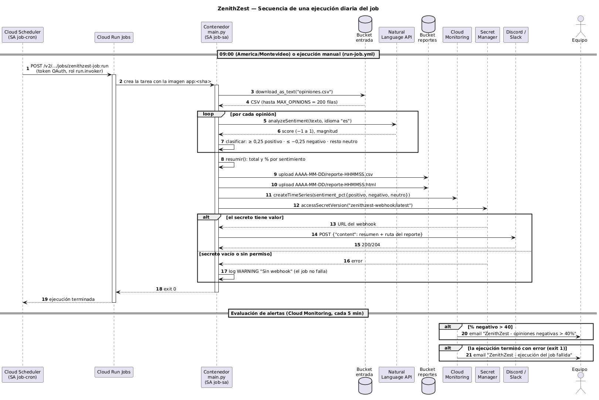
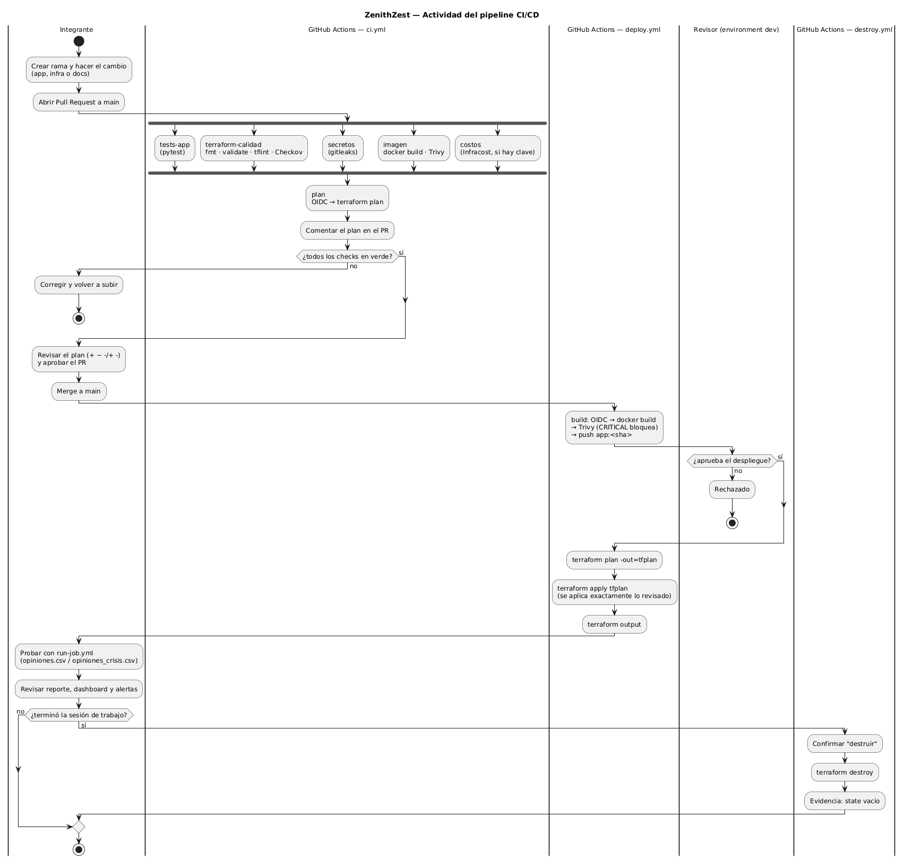
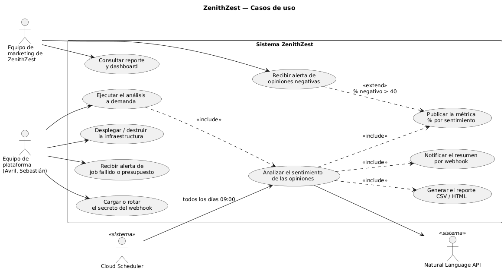

# Diagramas UML

Cinco diagramas, cada uno responde una pregunta distinta. Están escritos como código en PlantUML
(`docs/uml/*.puml`, *diagrams-as-code*) y exportados a PNG.

| Diagrama | Responde | Archivo |
|---|---|---|
| Despliegue | ¿Dónde corre cada cosa y cómo se comunican? | `uml/01-despliegue` |
| Componentes | ¿Cómo está armado el Terraform y qué depende de qué? | `uml/02-componentes` |
| Secuencia | ¿Qué pasa, paso a paso, cuando corre el job? | `uml/03-secuencia-job` |
| Actividad | ¿Cómo llega un cambio del PR a la nube? | `uml/04-actividad-cicd` |
| Casos de uso | ¿Quién usa el sistema y para qué? | `uml/05-casos-de-uso` |

## 1. Despliegue



- **Nodos** (cajas 3D): dónde se ejecuta algo. Hay tres "nubes": GitHub (el repo y el runner que corre los
  workflows), Google Cloud (todo lo que crea Terraform) y los sistemas externos (Discord/Slack y correo).
- **Artefactos** (hojas amarillas): lo que se despliega en cada nodo: `main.py` dentro del contenedor, la imagen
  `app:<sha>` en Artifact Registry, los CSV y reportes en los buckets, el state de Terraform.
- **Caminos de comunicación** (flechas) con el protocolo o la operación: el runner entra a Google Cloud con un
  **token OIDC** (sin claves), el Scheduler dispara el job por **HTTPS + OAuth**, el job habla con cada servicio
  por su API.
- Muestra los **límites de seguridad**: los buckets y el job no son públicos; solo el job sale hacia afuera
  (el webhook).

## 2. Componentes (Terraform)



- **Dos root modules**: `bootstrap` (una vez, a mano: lo que el pipeline necesita para existir) y `envs/dev`
  (todo lo demás, lo aplica el pipeline).
- **Cinco módulos por capacidad** (storage, job, secret, scheduler, monitoring), como pide la consigna.
- Las flechas sólidas son **outputs que pasan a variables** de otro módulo: por ejemplo, `storage` le pasa los
  nombres de los buckets a `job`, y `job` le pasa su cuenta de servicio (`member`) a `secret` y a `iam.tf` para
  darle solo los permisos que necesita.
- Las punteadas son **dependencias de uso**: el state vive en el bucket del bootstrap y el job usa la imagen del
  registro.

## 3. Secuencia: una ejecución del job



1. A las 09:00 (o a mano con `run-job.yml`) Cloud Scheduler pide a Cloud Run que ejecute el job.
2. El contenedor lee el CSV y, **por cada opinión** (`loop`), pide el sentimiento a la API y lo clasifica.
3. Resume, escribe el reporte CSV y HTML, y publica la métrica.
4. Lee el webhook del secreto: si tiene valor manda el resumen; si no, deja un WARNING y **no falla** (`alt`).
5. Cloud Monitoring evalúa las dos alertas y, si corresponde, manda el mail.

## 4. Actividad: pipeline CI/CD



- Cada **carril** es un responsable: la integrante, cada workflow y el revisor del environment.
- En el PR, los chequeos corren **en paralelo** (barra de *fork*) y después el plan, que queda comentado.
- Hay **dos compuertas humanas**: aprobar el PR (revisando el plan) y aprobar el despliegue en el environment `dev`.
- Se aplica **exactamente el plan revisado** (`plan -out` + `apply tfplan`).
- Al terminar la sesión, `destroy.yml` borra todo y deja la evidencia del state vacío.

## 5. Casos de uso



- **Actores humanos**: el equipo de marketing de la marca (consulta reportes y recibe la alerta de opiniones
  negativas) y el equipo de plataforma (despliega, destruye, ejecuta a demanda y gestiona el secreto).
- **Actores sistema**: Cloud Scheduler (dispara el análisis diario) y la Natural Language API (la usa el análisis).
- `<<include>>`: analizar siempre incluye generar el reporte, publicar la métrica y notificar.
- `<<extend>>`: la alerta de opiniones negativas solo ocurre cuando la métrica supera el 40 %.

## Regenerar las imágenes

```bash
docker run --rm -v "$PWD/docs/uml:/data" -w /data plantuml/plantuml:1.2024.7 -tpng *.puml
```

(También se pueden ver y editar en https://www.plantuml.com/plantuml o con la extensión PlantUML de VS Code.)
